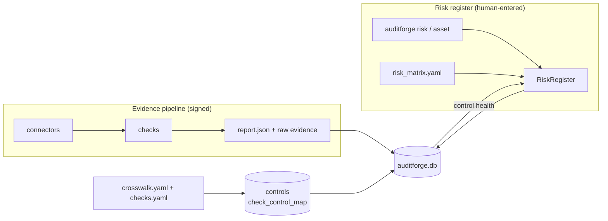
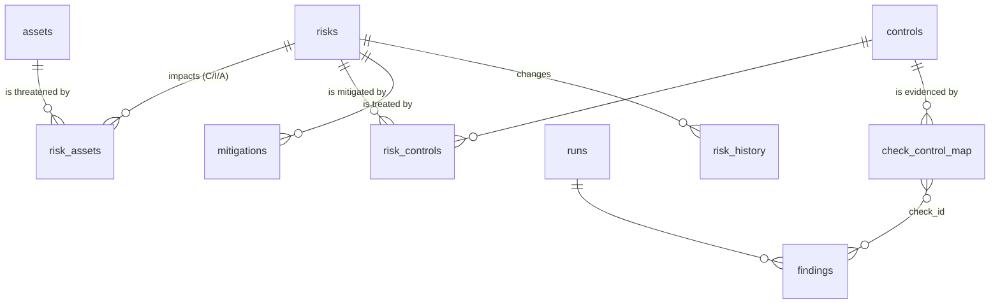

# Risk Register — design

Status: implemented (v1). Code: `auditforge/risk/`. Tests: `tests/test_risk_register.py`.

## Purpose

Give AuditForge an Eramba-style risk register that runs entirely on the operator's machine and
is tied to the same control catalog as the automated checks. A risk's residual score is only as
good as the controls it relies on, so the register shows, for each risk, the latest automated
evidence for those controls and flags a residual score that depends on a failing control.

## Concepts, borrowed from Eramba

| Eramba | AuditForge | Notes |
|---|---|---|
| Asset Management | `assets` | Owner and data classification per asset |
| Risk Management (asset risks) | `risks` + `risk_assets` | Asset impact recorded per CIA property |
| Risk classification and calculation | `mappings/risk_matrix.yaml` | Fixed 5x5 formula; labels, bands, appetite and categories are data |
| Risk treatment (mitigate / accept / transfer / avoid) | `risks.treatment` | |
| Internal controls / Compliance Management | `risk_controls` → `controls` | Same catalog (`crosswalk.yaml`) the checks map to |
| Control audits | automated `findings` | Latest result per check and per resource, linked through `check_control_map` |
| Projects / tasks for treatment | `mitigations` | Owner, status and due date per task |
| Audit trail | `risk_history` | Full JSON snapshot per change; append-only |

Not in v1: risk exceptions with approval workflow, periodic review reminders, third-party and
business-continuity risk types, custom fields. See [Roadmap](#roadmap).

## Architecture



The two halves share one database and one control catalog but stay separate:

- **Evidence** is machine-collected and signed. Checks never read the register.
- **The register** is entered by people. It is not signed, because its content is judgement,
  not observation. Its integrity comes from database constraints and an append-only history.
- **The join** is the control: a risk links to `SOC2 CC8.1`; check `GIT-CM-03` maps to
  `SOC2 CC8.1`; so the risk can show `GIT-CM-03`'s latest result.

## File structure

```
auditforge/
├── cli.py                  # registers the `risk` and `asset` command groups
├── identity.py             # operator name, recorded on runs and register changes
├── store.py                # core schema: runs, evidence, findings, controls, check_control_map
└── risk/
    ├── __init__.py
    ├── matrix.py           # RiskMatrix: load + validate risk_matrix.yaml, score(), band()
    ├── register.py         # SCHEMA, RiskRegister: assets, risks, links, mitigations, history
    └── cli.py              # typer commands: asset add/list, risk add/update/show/list/mitigate
mappings/
├── checks.yaml             # check -> objective
├── crosswalk.yaml          # objective -> framework controls; the controls catalog
└── risk_matrix.yaml        # 5x5 scale wording, bands, appetite, categories
docs/
└── risk-register.md        # this document
tests/
└── test_risk_register.py
```

## Data model



The new tables live in `auditforge.db` next to the existing ones (full DDL in
`auditforge/risk/register.py`):

| Table | Key columns | Integrity rules |
|---|---|---|
| `assets` | `asset_id` (`AST-001`), name, type, owner, classification | Type and classification from fixed lists |
| `risks` | `risk_id` (`R-001`), title, category, owner, inherent L/I, residual L/I, treatment, status, review date | `inherent_score` and `residual_score` are **generated columns** (`L * I`), so they can't be written or drift. Residual is a pair (both or neither) and can't exceed inherent. Risks can't be deleted; close them with `status=closed`. |
| `risk_assets` | (risk, asset, impact_type) | Impact type is confidentiality, integrity or availability |
| `risk_controls` | (risk, framework, control_id) | Foreign key to `controls`, so only catalogued controls can be linked |
| `mitigations` | id (`M-1`), risk, description, owner, status, due date | Status: planned, in_progress, implemented, verified, cancelled |
| `risk_history` | id, risk, changed_at, changed_by, action, snapshot JSON | Triggers reject UPDATE and DELETE |

Why SQLite rather than JSON files: the relationships (risk ↔ asset ↔ control ↔ finding) need
foreign keys, and the existing runs and findings are already in `auditforge.db`, so control
health is a single query. `risk list --json` gives a portable export.

## Scoring method

```
score = likelihood x impact          each 1..5, so score is 1..25
```

| Band | Scores |
|---|---|
| Low | 1–4 |
| Medium | 5–9 |
| High | 10–16 |
| Critical | 20–25 |

- **Inherent** risk: likelihood and impact assuming no controls.
- **Residual** risk: after the linked controls and implemented mitigations. It must not be
  higher than inherent.
- **Appetite** (default 9): a residual score above it needs a treatment plan. Accepting it is
  allowed but flagged.

The level descriptions (e.g. impact 4 = "Regulatory notification or significant deficiency;
$1M to $10M") are in `risk_matrix.yaml` so a risk committee can adopt its own wording. The
file's SHA-256 is included in `risk list --json` so an export records which method scored it.

## Warnings

`risk show` and `risk list` flag a risk when:

1. residual risk has not been assessed;
2. the residual score is lower than inherent **and** a linked control's latest automated
   evidence FAILED for some resource ("residual score may be understated");
3. the risk is accepted with a residual score above appetite.

"Latest" is per check **and per resource**: a newer passing run against a different repo must
not hide a failure in this one.

## CLI

```sh
auditforge asset add --id AST-001 --name "Customer payments database" --type data \
    --owner "Priya Shah" --classification restricted

auditforge risk add --title "Customer data leaked from production database" \
    --category "Information security" --owner "Priya Shah" \
    --likelihood 4 --impact 5 --residual-likelihood 2 --residual-impact 5 \
    --asset AST-001:C --control SOC2:CC6.1 --control ISO27001:A.8.24 --review-date 2026-12-31

auditforge risk update R-001 --status treatment_in_progress --residual-likelihood 3
auditforge risk mitigate R-001 --description "Encrypt backups with KMS" --owner "Tom Okafor" --due 2026-11-30
auditforge risk mitigation-status M-1 --status implemented
auditforge risk show R-001 --history
auditforge risk list            # table + 5x5 residual heat map
auditforge risk list --json     # export, including bands, warnings and control health
```

`update` changes only the options given. `--asset` or `--control` on update replace the whole
list. Invalid input exits with code 2 and says what to fix.

## UI (planned)

A modern, light, self-contained HTML view written by the CLI (`auditforge view`), with no
server and no network. Risk views: a 5x5 heat map (inherent and residual, with arrows showing
movement), the register table sorted by residual score, and a risk detail page with assets,
controls and their latest evidence, mitigations and history.

## Roadmap

- **Risk exceptions**: formal acceptance with approver, rationale and expiry, reusing the
  `exceptions` pattern from findings.
- **Reviews**: `risk review R-001` records a dated review; `risk list --overdue`.
- **Excel workpaper export**: register tab plus a heat map tab.
- **Assets from evidence**: suggest assets from connectors (repos, cloud accounts).
